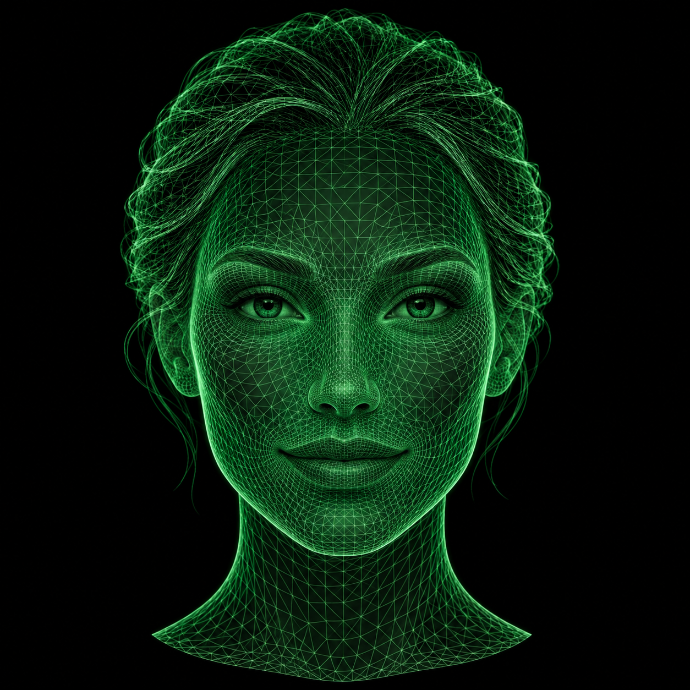
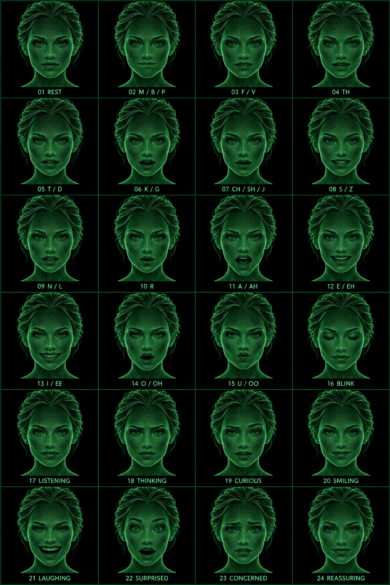

# Speakrail Mac

An unofficial Apple Silicon port of [Speakrail](https://github.com/speakrail/speakrail),
with local speech recognition, conversation and speech output. It keeps
Speakrail's conversation controller and models, using Metal and MLX in place
of the NVIDIA backends.

## What This Fork Adds

Beyond the native Mac port, this fork adds Astra and the animation and speech
timing needed to use her in conversation:

- **Apple Silicon serving:** Metal speech recognition and MLX conversation and
  speech synthesis, with local startup, shutdown and session-scoped caching.
- **Astra's face:** the portrait mapped onto a skinned 3D rig, rendered locally
  with Three.js. Lip, jaw, teeth and tongue movement follow phoneme timing from
  the generated speech rather than cycling through still images.
- **Idle and listening motion:** blinking, gaze and subtle head/neck movement,
  a neutral listening posture, and corrected hair movement so it follows the
  face rather than staying fixed while the head moves.
- **Speech and controls:** pitch-preserving pace options, alignment after tempo
  changes, a separate greeting preview, and framing adjustments for desktop
  and smaller screens.
- **Lip-sync recovery:** bounded speech clauses, checks for missing or held
  phonemes, and audio-only recovery when transcript alignment fails. Successful
  recovery stays quiet; genuine timing failures still show a warning.
- **Avatar choice:** Astra is the default, with the original orb still available,
  a saved browser preference and an orb fallback if the face cannot load.

Speakrail's original authors supplied the conversation controller, training
work, models and base UI. This fork builds on that work and uses the credited
CC0 MPFB rig and MIT-licensed Three.js; it does not claim to have created those
components. The original portrait and pose sheet are included with their
provenance intact. See [Licensing and Credits](#licensing-and-credits).

This repository is the standalone voice assistant. The separate private
Qwen/Tavily/RAG harness integration is not included.
The UI can display grouped news results supplied by an integration, with
numbered stories and per-country counts. This does not enable web search in the
standalone Mac launcher.

## Astra

Astra is the default avatar: a green portrait mapped onto an animated 3D face.
She blinks and moves while idle, settles into a neutral listening pose, and
uses phoneme timing from the spoken audio to move her mouth.



The image above is the original artwork, not a screenshot of the animation.
Choose **Settings > Visualization > Orb (original)** to use the previous
graphic. Your selection is remembered in the same browser, including when
you reopen a preview link. If the face cannot load, the orb takes over without
overwriting your preference.

**Preview speech** plays "Hi, I'm Astra. How is your day going today?" without
opening the microphone. Speech pace defaults to **Relaxed**; **Slow** and
**Original** are also available. The greeting is a synthetic sample, not a
recording of a person, and does not play automatically on connection.

### Portrait and Pose Sheet

The [original portrait](app/web/live/assets/mesh-face/portrait-reference.png)
and [24-pose contact sheet](app/web/live/assets/mesh-face/contact-sheet.png)
are included. The sheet was used for the earlier sprite prototype; the current
avatar uses a skinned rig rather than switching between these images.

<details>
<summary>View the speech shapes and expressions</summary>



</details>

The face is designed for a frontal view, not large turns. Lip sync buffers a
complete speech clause before playback, adding latency compared with the orb.
See [avatar setup and limitations](mac/LIP_SYNC.md) and
[asset credits](app/web/live/assets/mesh-face/README.md).

## Status

This is experimental. Tested on an Apple M5 Max with 128 GB unified memory.
Local speech recognition, conversation and speech output work together.
Automated tests include real model inference, synthetic microphone input,
browser audio playback and spoken interruption. It has also been tried in
conversation. Other Apple Silicon generations and memory sizes have not
been tested.

This version runs as a standalone voice assistant. Claude Bridge, hosted
models and general web search
are disabled by the Mac launcher. Do not use the original Docker instructions
for the native Mac path.

## Quick Start

Prerequisites: Apple Silicon macOS, Xcode Command Line Tools, Git, CMake,
FFmpeg and [uv](https://docs.astral.sh/uv/). Python 3.12 is used in three
isolated environments. Allow approximately **50 GB free disk for setup**;
the tested installation occupied about 24 GB after download-cache cleanup.
There is no validated minimum memory specification yet.

```sh
git clone --branch macos https://github.com/jimliddle/speakrail-mac.git
cd speakrail-mac

# First read the licensing section below, particularly Breeze's restrictions.
./mac/setup-mac --with-lip-sync --download-models --accept-breeze-noncommercial-license
./mac/start-voice-prototype
```

Open **http://127.0.0.1:18180/** in Chrome initially and click
**Allow microphone & start**. Give the session a couple of seconds to warm up.
Use headphones for the first trial. Try a short question, a follow-up, a
mid-sentence pause, and "Stop talking" during a longer response.

The setup script downloads specific versions of the dependencies, builds
audio.cpp, creates Python environments inside the repository and optionally
downloads the models. It does not install system packages or a background service. Inspect
its commands without making changes with `./mac/setup-mac --plan`.
The installer has not yet been tested on a second, clean Mac. The working
installation was built and tested in stages.

**Interrupt** cuts a reply. **Stop** ends microphone capture and playback;
models stay loaded. Ctrl-C in the launch terminal shuts down the stack.
Use `--port 18181` if port 18180 is occupied.

For an existing installation, install the aligner before trying Astra:

```sh
uv pip install --python mac/.venv/bin/python --no-deps --only-binary=:all: \
  -r mac/requirements-lipsync.lock.txt
```

To try the avatar and greeting without loading the conversation models, run
`./mac/preview-mesh` and open **http://127.0.0.1:18182/**. This sample page does
not accept microphone input. The normal launcher uses Astra's name; pass
`--persona nova` to retain the original conversation persona.

## Architecture

| Component | Native Mac path |
| --- | --- |
| Recognition and turn head | Voxtral Mini 4B realtime Q8, audio.cpp Metal, original Speakrail ASR bridge |
| Conversation and decisions | Gemma 4 12B QAT with Speakrail LoRA/token rows, narrow MLX completion server |
| Speech synthesis | Breeze TTS 2 MLX 8-bit through the pinned Mac-compatible Breeze implementation |
| Interaction | Astra or original orb, interjections, speculative responses and ducking |

The Gemma loader preserves the packed int4 weights rather than requantising
them. Prefix caching is bounded and separated by session and base/LoRA model.
The server currently caps prompts at 8,192 tokens and output at 512 tokens,
uses greedy sampling, and is not a general purpose vLLM replacement.
Pre rendered phrase caching is disabled.
Optional background listening notes are also disabled: the local completion
server does not expose the separate chat endpoint they need. Conversation
history and the explicit note/list tools remain available.

## Local Inference, Not Network Isolated

**Gemma is local, it is not a connection to Google's Gemini service.**
All three inference servers listen on loopback. Session recording is off by
default. The main UI rejects foreign browser origins and allows one session
at a time. This is a local prototype, not a remotely exposed service.

Some original tools remain enabled: calculator, time, session notes/lists,
and **weather via Open-Meteo**. Weather sends the requested location and then
coordinates to that service; general web search being off does not disable
weather. Weather data attribution: [Open-Meteo](https://open-meteo.com/),
[CC BY 4.0](https://creativecommons.org/licenses/by/4.0/).
The live avatar, renderer and fonts use local assets or system resources.
The older debug UI still requests Google Fonts. Model downloads require
internet access during setup.

The upstream Claude Bridge source remains, but the Mac launcher does not enable it or connect to an account.

## Test Results

Results from short tests on the M5 Max:

| Probe | Result |
| --- | --- |
| Bundled sample transcription | No word errors in two runs |
| Warm TTS time to first audio | About 153 ms |
| Original streaming orb: input end to first output, after session warm-up | About 928 ms |
| Spoken interruption to controller stop | About 1.16 seconds |
| Browser | Synthetic microphone, non-silent playback, desktop/mobile checks passed |

First-use latency is higher. These are not acoustic speaker-latency measurements
or an evaluation of accuracy across accents, noise and long conversations.
Astra's clause buffering and alignment add delay; the streaming-orb timing
above does not describe the face mode. Avatar checks cover speech timing,
interruption, idle and listening motion, saved preferences, desktop/mobile
framing and fallback when WebGL or an asset fails. They do not establish
natural-looking speech across all voices or browsers.
See [Mac testing](mac/TESTING.md), [port changes](mac/PORTING.md) and
[upstream documentation](README.upstream.md).

## Licensing and Credits

Speakrail and this port's source changes are distributed under **Apache-2.0**.
The original [LICENSE](LICENSE) and [NOTICE](NOTICE) are retained. Credit for
the original controller, training work, models and UI belongs to the
Speakrail authors and their dependencies; this fork adds the native Mac path
and Astra visualization. The MPFB rig is CC0 and Three.js is MIT-licensed;
their notices and the portrait/contact-sheet provenance are included.

**The complete voice stack is not unrestricted for commercial use.** Breeze
TTS 2 model weights, derivatives and generated speech are subject to the
**BreezeBlue Research and Non-Commercial License**. The bundled upstream
`app/voices/female_a.wav` reference and `app/voices/astra_intro.wav` greeting
are synthetic Breeze output and have those terms too. A separate licence is
required for commercial use. This differs
from the Apache-licensed serving source code.

Read the [Breeze licence](mac/licenses/BREEZE-MODEL-LICENSE.txt) and the
[third-party summary](mac/THIRD_PARTY.md). We publish no model weights,
downloaded tokenizers, virtual environments, generated test audio, recordings
or private test logs. Downloaded components retain their own terms.

## Removal

Stop the launch terminal, then delete the clone. Models, downloaded sources,
environments and runtime artifacts are contained under `mac/`. No SwiftBar
item, LaunchAgent or system-wide model configuration is installed.
